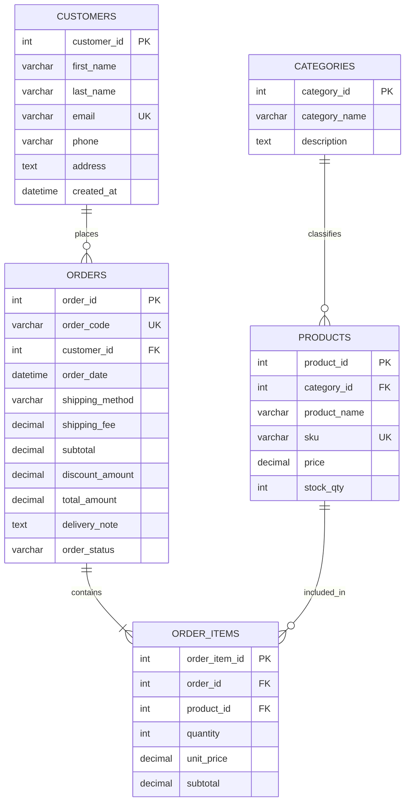

# E-Commerce Order Database — Entity Relationship Diagram (ERD)

## 1. Mermaid ERD Diagram

## 2. Table Relationships Summary

1. **Customers → Orders (`1 : N`)**
   - One customer can place many orders (`Customers.customer_id` → `Orders.customer_id`).
2. **Orders → Order_Items (`1 : N`)**
   - One order consists of one or more order items (`Orders.order_id` → `Order_Items.order_id`).
3. **Categories → Products (`1 : N`)**
   - One category organizes many products (`Categories.category_id` → `Products.category_id`).
4. **Products → Order_Items (`1 : N`)**
   - One product can appear in many order line items (`Products.product_id` → `Order_Items.product_id`), resolving the Many-to-Many (`M : N`) relationship between `Orders` and `Products`.
